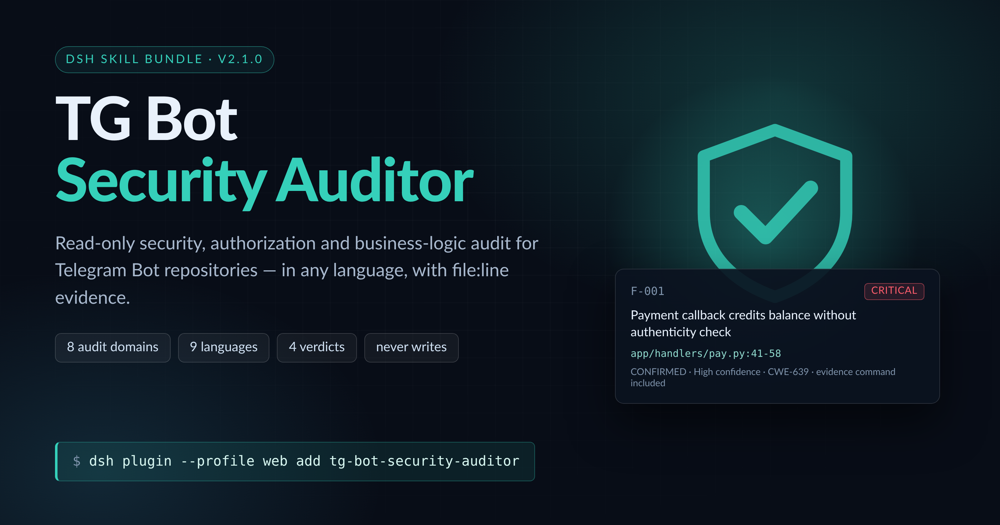
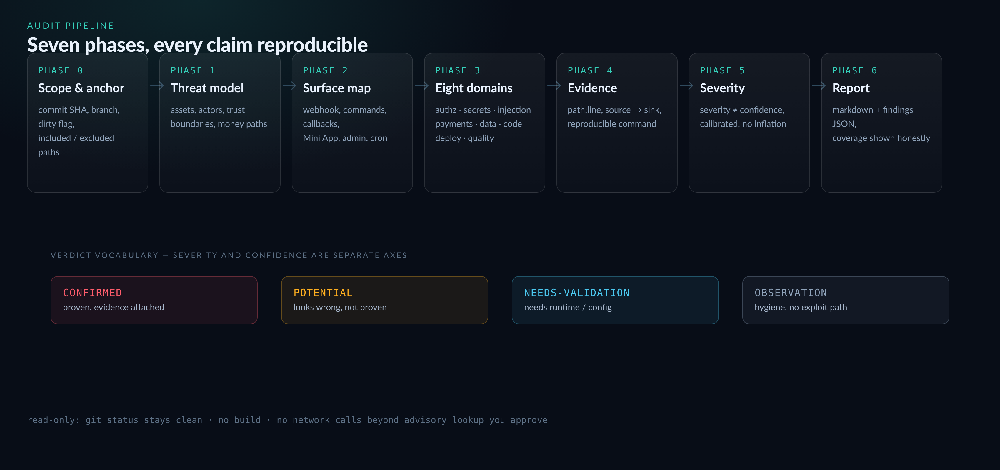
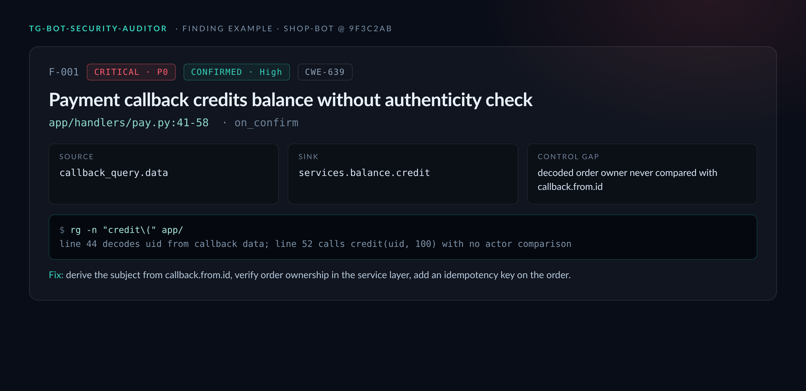

# TG Bot Security Auditor

<p align="center">
  
  
  
  
  
  
</p>

[中文](README.md) · **English**

A DeepSeek Harness (DSH) skill bundle for read-only security, authorization and business-logic audits of Telegram Bot repositories — every finding carries `file:line` evidence, and **your project is never modified**.

- Open-sourced by TG KunKun [@sad1881](https://t.me/sad1881) · available for custom work

---



## What it is

Install it into DeepSeek Harness and just ask:

> Audit this Telegram bot repo. Focus on payments and callback authorization.

It walks a fixed seven-phase pipeline: anchor the commit → build a threat model → map the attack surface → sweep eight domains → gather evidence → grade severity → produce a report (Markdown + `findings.json`).

What sets it apart from "let the model read the code once":

- **Anchored scope** — the report header pins the commit SHA, branch, dirty flag, the paths reviewed and the paths excluded.
- **Four verdicts** — `CONFIRMED`, `POTENTIAL`, `NEEDS-VALIDATION`, `OBSERVATION`. Severity and confidence are separate axes and are never merged.
- **Reproducible evidence** — every finding has `location.path:lines` plus a read-only search command, so anyone can re-run it and see the same code.

## What it does not do

| Constraint | Detail |
|---|---|
| No edits | No writes, no patches, no commits; `git status` is identical before and after |
| No build or test runs | Static reading and read-only search only, to avoid side effects |
| No destructive probing | No live payloads against production; verification steps are written for an isolated copy |
| No uncontrolled lookups | Advisory lookups (OSV / GitHub Advisory) name their source before running |

## Install

**From the plugin market** — search for `tg-bot-security-auditor` in dshmarket and click install.

**From the CLI**:

```bash
# once published to npm
dsh plugin --profile web add tg-bot-security-auditor

# or straight from this repository
dsh plugin --profile web add github:KunKun24/tg-bot-security-auditor
```

Start a new session afterwards; no configuration is required. The skill ships inside the package and updates with the plugin.

## Example

```text
You:   audit /root/shop-bot, payments and callbacks first
It:    read-only recon, lists layout, framework, entry points, proposes scope, waits for approval
You:   approved
It:    runs all seven phases, writes report.md + findings.json
```

Excerpt of a typical output:

```text
F-001  Critical / CONFIRMED   app/handlers/pay.py:41-58
       Payment callback credits balance without authenticity check
       source: callback_query.data → sink: services.balance.credit
       evidence: rg -n "credit\(" app/
```

## Audit pipeline



Seven phases: `0` scope and anchor → `1` threat model → `2` surface map → `3` eight domains → `4` evidence → `5` severity → `6` report. Each phase has a concrete output and an exit condition — never a vague "I've looked at it".

## Coverage

**Eight domains** — authentication and authorization, secrets and configuration, injection and deserialization, payments and accounting, data and storage, dependencies and supply chain, deployment and runtime, code quality and maintainability.

**Dangerous-API maps for nine languages** — Python, Node.js, PHP, Go, Java/Kotlin, Rust, C#, Ruby — plus framework-level differences in middleware and authorization placement (aiogram, python-telegram-bot, Telegraf, grammY, nestjs-telegraf, Laravel, Spring, …).

Telegram-specific checkpoints live in their own rule file: constant-time `secret_token` comparison on webhooks, IP allowlists are not authentication, `from.id` / `chat.id` / `sender_chat` must not be conflated, `answerCallbackQuery` is not authorization, `initData` needs HMAC verification and `initDataUnsafe` is untrusted, payments are idempotent by provider `charge_id`, and HTML vs MarkdownV2 escaping are audited separately.

## Anatomy of a finding



Fields: `id`, `title`, `severity`, `priority`, `status`, `confidence`, `category`, `cwe`, `fingerprint`, `location`, `source`, `sink`, `control_gap`, `preconditions`, `evidence_cmd`, `evidence`, `control_elsewhere`, `impact`, `root_cause`, `remediation`, `verification`, `authorization_row`, `tags`.

The machine-readable format lives in [`findings.schema.json`](skills/tg-bot-security-auditor/assets/findings.schema.json); [`findings.example.json`](skills/tg-bot-security-auditor/assets/findings.example.json) has one real example per verdict and validates with the bundled script:

```bash
cd skills/tg-bot-security-auditor
python3 scripts/validate_findings.py --allow-missing-paths assets/findings.example.json
# VALID: 4 finding(s), coverage 10 domain(s)
```

## Example configuration

The plugin works out of the box. Use [`examples/config.example.yml`](examples/config.example.yml) only if you need to pin the bundle id or replace it with a locally maintained skill copy:

```yaml
- insert:
    - id: tg-bot-security-auditor
      name: 'tg-bot-security-auditor'
```

## Repository layout

```text
tg-bot-security-auditor/
├── package.json              # DSH bundle manifest (dsh.bundle.patch)
├── cordis.patch.yml          # registers the plugin entry
├── index.js                  # exposes skills/ as a skill provider
├── skills/tg-bot-security-auditor/
│   ├── SKILL.md              # skill body (English)
│   ├── SKILL.zh.md           # skill body (Chinese)
│   ├── rules/                # eight domains + rules/langs/ for nine languages
│   ├── references/           # threat model, authorization matrix, report template, safe commands
│   ├── examples/             # eight vuln classes: bad code / good code / how to prove it
│   ├── assets/               # findings JSON Schema and examples
│   └── scripts/              # validate_findings.py
├── examples/config.example.yml
├── docs/                     # methodology, submission notes, screenshots
└── scripts/check.py          # repository self-check
```

## Compatibility

| Item | Requirement |
|---|---|
| DeepSeek Harness | `>= 1.0.0` |
| Node.js | `>= 20` |
| Host skill framework | `@deepseek-ai/dsh-skill-filesystem` `>=0.1.0-rc.6 <0.3.0` |
| Audited project languages | Python / Node.js / PHP / Go / Java / Kotlin / Rust / C# / Ruby |
| Audited project frameworks | aiogram, python-telegram-bot, Telegraf, grammY, nest.js, Laravel, Spring, … |

## Documentation

- [Audit methodology](docs/en/audit-method.md) — six tests, why severity and confidence stay separate, how re-audits are diffed
- [Submission and disclosure](docs/en/submission.md) — market fields, screenshot list, link list, security disclosure
- Skill references: [threat model](skills/tg-bot-security-auditor/references/threat-model.md), [authorization matrix](skills/tg-bot-security-auditor/references/authorization-matrix.md), [report template](skills/tg-bot-security-auditor/references/report-template.md), [safe commands](skills/tg-bot-security-auditor/references/safe-commands.md)

## Development and self-check

A dependency-free checker validates manifest consistency, bilingual pairs, relative links, trailing whitespace and the findings schema:

```bash
python3 scripts/check.py            # exit code 0 when clean
```

CI runs the same script on every push and PR, plus `validate_findings.py` against the example JSON.

## License

[MIT](LICENSE). Audit conclusions are the shared responsibility of the operator and the model performing the audit; this skill offers no compliance endorsement of any kind.

## About AIGC

> This project contains AI-generated (AIGC) code and documentation, mainly rule entries, example snippets and documentation drafts. Every rule, checkpoint and example has been manually audited and individually verified by the maintainer, and exercised against real projects. Full attack-surface coverage is not guaranteed, and audit conclusions still require human review. Issues pointing out wrong or missing rules are welcome.

---

<div align="center">
  <sub>Open-sourced by TG KunKun · <a href="https://t.me/sad1881">@sad1881</a> · available for custom work</sub>
</div>
