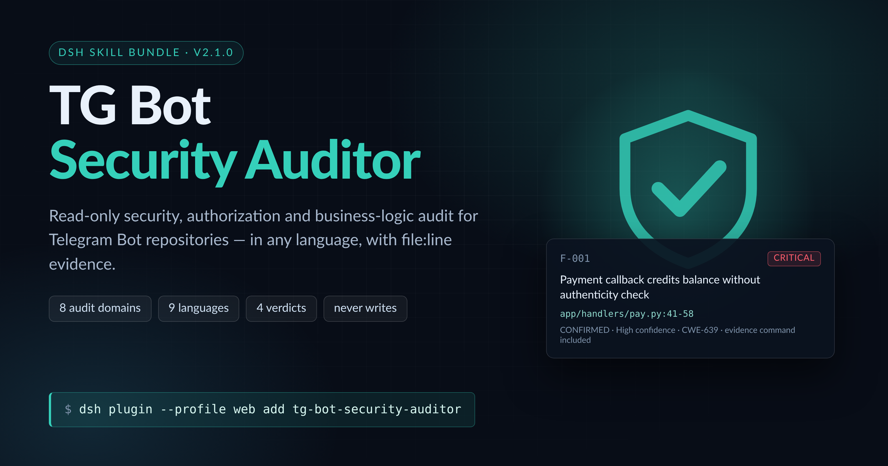
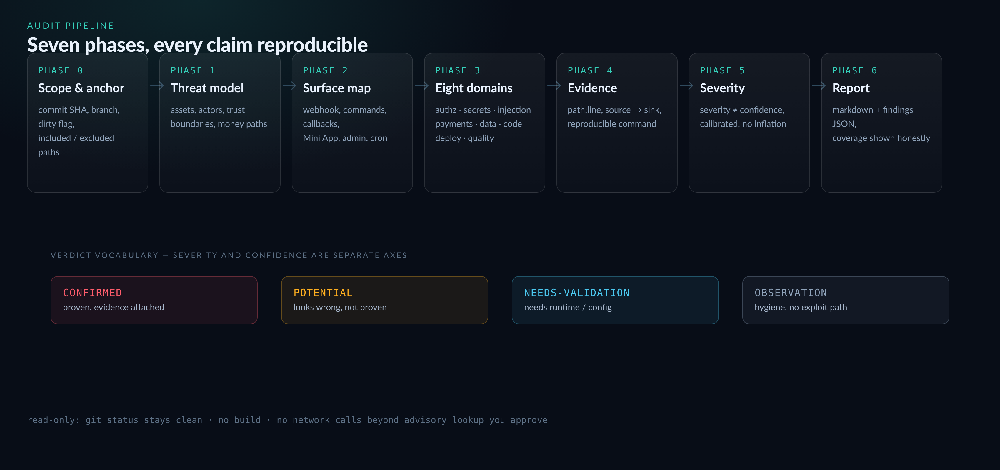
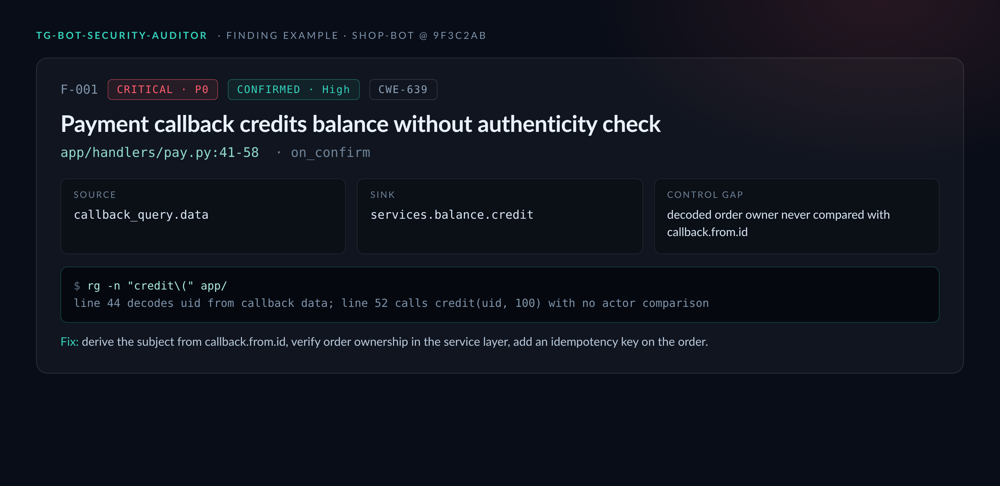

# TG Bot Security Auditor

<p align="center">
  
  
  
  
  
  
</p>

**中文** · [English](README.en.md)

只读审计 Telegram Bot 仓库的 DSH 技能包：授权、支付、注入、密钥、依赖、部署、业务逻辑全覆盖，每条结论都带 `文件:行号` 与可复现证据，**不改动被审项目一行代码**。

- 由 TG 困困开源 [@sad1881](https://t.me/sad1881) 困困承接各种业务 欢迎咨询

---



## 这是什么

一个装进 DeepSeek Harness（DSH）的技能包。装上之后，你可以直接对 Agent 说：

> 审计这个 TG 机器人项目，重点看支付和回调授权。

它就会按固定的七阶段流程走完：锚定 commit → 建威胁模型 → 画攻击面 → 按 8 个域逐条过 → 证据化验证 → 定级 → 出报告（Markdown + `findings.json`）。

和"让模型随便看一遍代码"的区别在于三点：

- **锚点固定**：报告头部写死 commit SHA、分支、是否 dirty、审了哪些目录、哪些排除在外。
- **结论分四档**：`CONFIRMED`（已证实）、`POTENTIAL`（疑似）、`NEEDS-VALIDATION`（需要运行态/配置才能确认）、`OBSERVATION`（卫生问题）。严重度和置信度是两个独立维度，不允许混用。
- **证据可复现**：每条发现都有 `location.path:lines` 和一条只读检索命令，换个人跑一遍就能看到同样的代码。

## 它不做什么

| 约束 | 说明 |
|---|---|
| 不修改代码 | 不写文件、不打补丁、不提交；审计结束 `git status` 与开始时一致 |
| 不跑构建/测试 | 只做静态阅读与只读检索，避免副作用 |
| 不做破坏性探测 | 不在真实环境打 payload；验证建议写成"在隔离副本里怎么做" |
| 不联网乱查 | 依赖漏洞查询会先说明来源（OSV / GitHub Advisory）再执行 |

## 安装

**从插件市场**（dshmarket 里搜索 `tg-bot-security-auditor`，点安装）。

**从命令行**：

```bash
# npm 发布后
dsh plugin --profile web add tg-bot-security-auditor

# 或直接从本仓库安装
dsh plugin --profile web add github:KunKun24/tg-bot-security-auditor
```

安装后新开一个会话即可，无需额外配置。技能目录随包内嵌，升级时随插件一起更新。

## 用法示例

```text
你：审计 /root/shop-bot，支付和回调这块重点看
它：先跑只读侦察，列出目录、框架、入口点，给出审计范围，等你确认
你：确认
它：七阶段走完，输出 report.md + findings.json
```

典型输出（节选）：

```text
F-001  Critical / CONFIRMED   app/handlers/pay.py:41-58
       Payment callback credits balance without authenticity check
       source: callback_query.data → sink: services.balance.credit
       evidence: rg -n "credit\(" app/
```

## 审计流程



七个阶段：`0` 范围与锚点 → `1` 威胁模型 → `2` 攻击面图 → `3` 八个域逐条过 → `4` 证据化验证 → `5` 定级 → `6` 报告。每个阶段有明确的产出物和退出条件，不做"看完了"这种模糊结论。

## 覆盖范围

**八个审计域**：认证与授权、密钥与配置、注入与反序列化、支付与账务、数据与存储、依赖与供应链、部署与运行时、代码质量与可维护性。

**九种语言的危险 API 对照**：Python、Node.js、PHP、Go、Java/Kotlin、Rust、C#、Ruby，以及框架层（aiogram / python-telegram-bot / Telegraf / grammY / nestjs-telegraf / Laravel / Spring 等）的中间件与授权落点差异。

Telegram 专属检查点单独成册：webhook `secret_token` 常量时间比较、IP 白名单不等于认证、`from.id` / `chat.id` / `sender_chat` 不可混用、`answerCallbackQuery` 不是授权、`initData` 必须验 HMAC 且 `initDataUnsafe` 不可信、支付以 provider `charge_id` 幂等、HTML 与 MarkdownV2 转义分开审。

## 一份发现长什么样



字段：`id`、`title`、`severity`、`priority`、`status`、`confidence`、`category`、`cwe`、`fingerprint`、`location`、`source`、`sink`、`control_gap`、`preconditions`、`evidence_cmd`、`evidence`、`control_elsewhere`、`impact`、`root_cause`、`remediation`、`verification`、`authorization_row`、`tags`。

机器可读的格式见 [`skills/tg-bot-security-auditor/assets/findings.schema.json`](skills/tg-bot-security-auditor/assets/findings.schema.json)，四档状态各有一条真实示例：[`findings.example.json`](skills/tg-bot-security-auditor/assets/findings.example.json)，可用仓库自带脚本校验：

```bash
cd skills/tg-bot-security-auditor
python3 scripts/validate_findings.py --allow-missing-paths assets/findings.example.json
# VALID: 4 finding(s), coverage 10 domain(s)
```

## 示例配置

插件即装即用，不需要配置。需要固定 id 或改用项目内自维护的技能副本时，参考 [`examples/config.example.yml`](examples/config.example.yml)：

```yaml
- insert:
    - id: tg-bot-security-auditor
      name: 'tg-bot-security-auditor'
```

## 目录结构

```text
tg-bot-security-auditor/
├── package.json              # DSH bundle 清单（dsh.bundle.patch）
├── cordis.patch.yml          # 注册插件条目
├── index.js                  # 把 skills/ 注册为技能来源
├── skills/tg-bot-security-auditor/
│   ├── SKILL.md              # 技能主体（英文）
│   ├── SKILL.zh.md           # 技能主体（中文）
│   ├── rules/                # 八个域 + rules/langs/ 九种语言
│   ├── references/           # 威胁模型、授权矩阵、报告模板、只读命令白名单
│   ├── examples/             # 八类典型漏洞的"坏代码 / 好写法 / 怎么证明"
│   ├── assets/               # findings JSON Schema 与示例
│   └── scripts/              # validate_findings.py
├── examples/config.example.yml
├── docs/                     # 审计方法论、收录说明、截图
└── scripts/check.py          # 仓库自检
```

## 兼容性

| 项 | 要求 |
|---|---|
| DeepSeek Harness | `>= 1.0.0` |
| Node.js | `>= 20` |
| 宿主技能框架 | `@deepseek-ai/dsh-skill-filesystem` `>=0.1.0-rc.6 <0.3.0` |
| 被审项目语言 | Python / Node.js / PHP / Go / Java / Kotlin / Rust / C# / Ruby |
| 被审项目框架 | aiogram、python-telegram-bot、Telegraf、grammY、nest.js、Laravel、Spring 等 |

## 文档

- [审计方法论](docs/audit-method.md)：六个判断标准、为什么严重度和置信度要分开、复审计怎么对比
- [收录与举报](docs/submission.md)：市场收录字段、截图清单、链接清单、安全披露方式
- 技能内部参考：[威胁模型](skills/tg-bot-security-auditor/references/threat-model.md)、[授权矩阵](skills/tg-bot-security-auditor/references/authorization-matrix.md)、[报告模板](skills/tg-bot-security-auditor/references/report-template.md)、[只读命令白名单](skills/tg-bot-security-auditor/references/safe-commands.md)

## 开发与自检

仓库自带一个无依赖自检脚本，检查 manifest 一致性、双语配对、相对链接、行尾空白与 findings schema：

```bash
python3 scripts/check.py            # 全绿则退出码 0
```

CI 在每次 push 与 PR 时跑同一脚本，另加 `validate_findings.py` 对示例 JSON 做校验。

## 许可证

[MIT](LICENSE)。审计结论由使用者与执行审计的模型共同负责；本技能不提供任何形式的合规背书。

## 关于 AIGC

> 本项目包含 AIGC（AI 生成内容）辅助完成的代码与文档，主要涉及规则条目、示例代码片段与文档初稿。所有规则、检查点与示例均已由维护者人工审计、逐条核对，并在真实项目上试跑过；不保证覆盖所有攻击面，审计结论仍需人工复核。如发现规则错误或遗漏，欢迎开 issue。

---

<div align="center">
  <sub>由 TG 困困开源 · <a href="https://t.me/sad1881">@sad1881</a> · 困困承接各种业务 欢迎咨询</sub>
</div>
